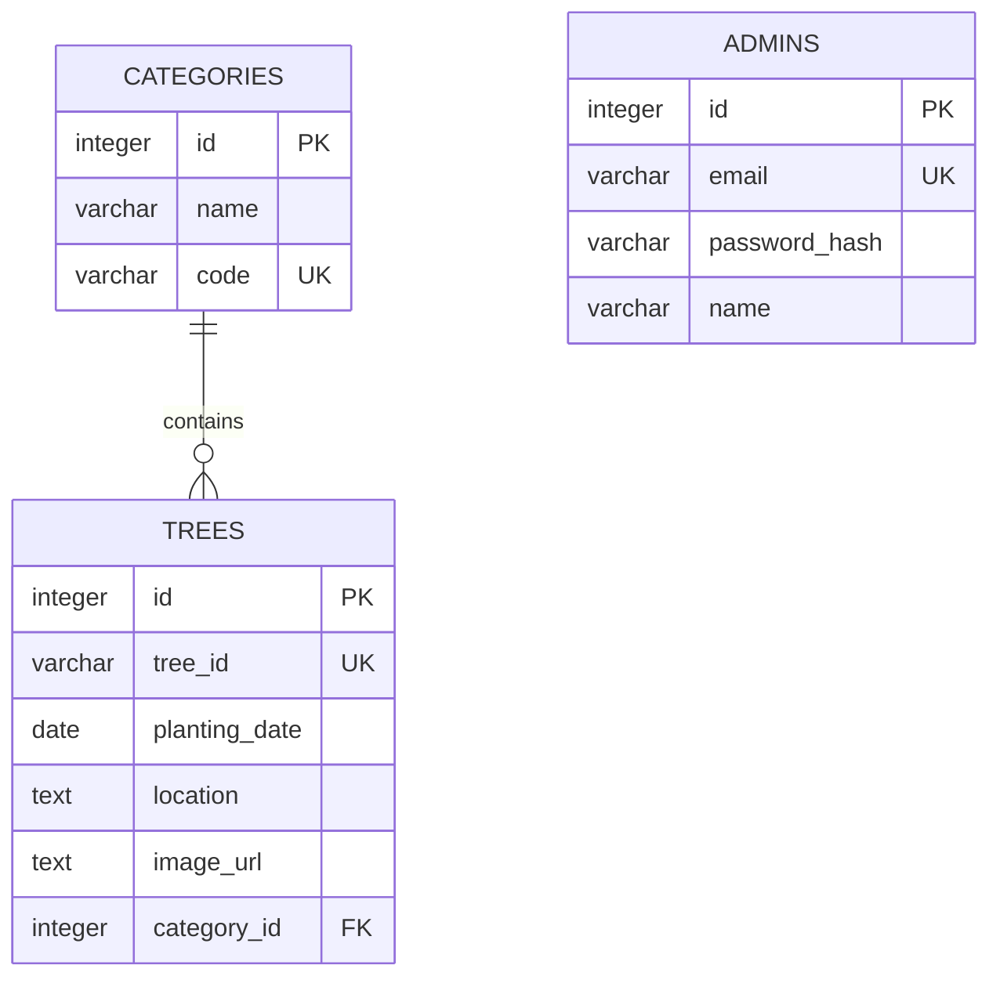
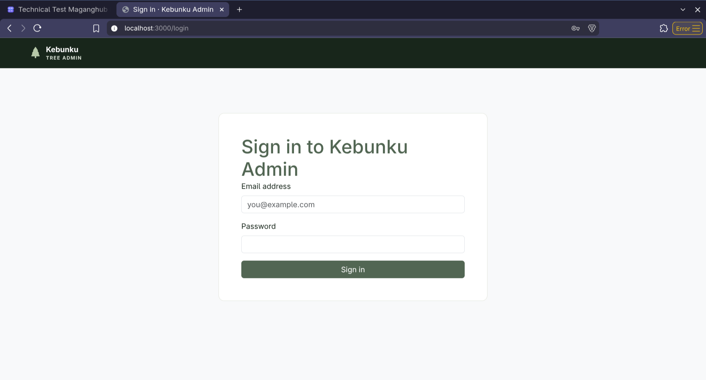
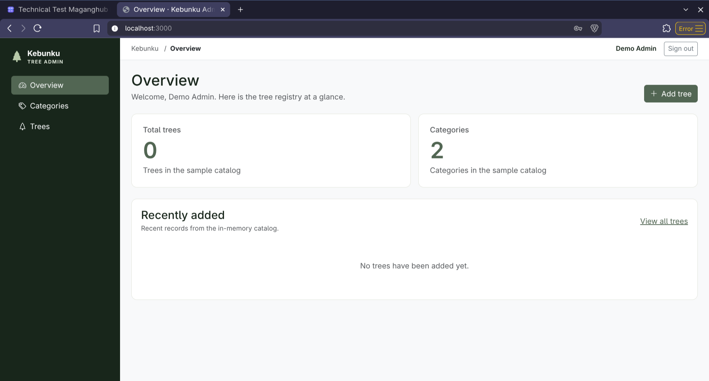
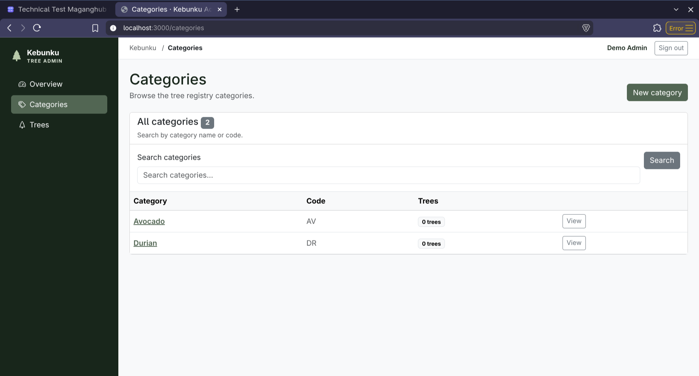
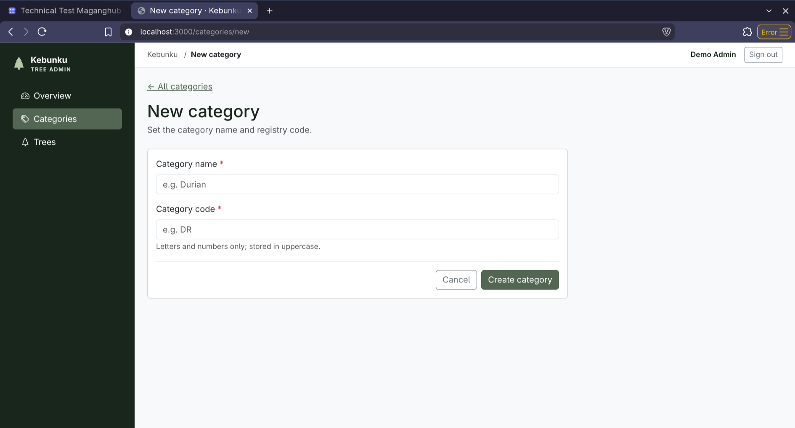
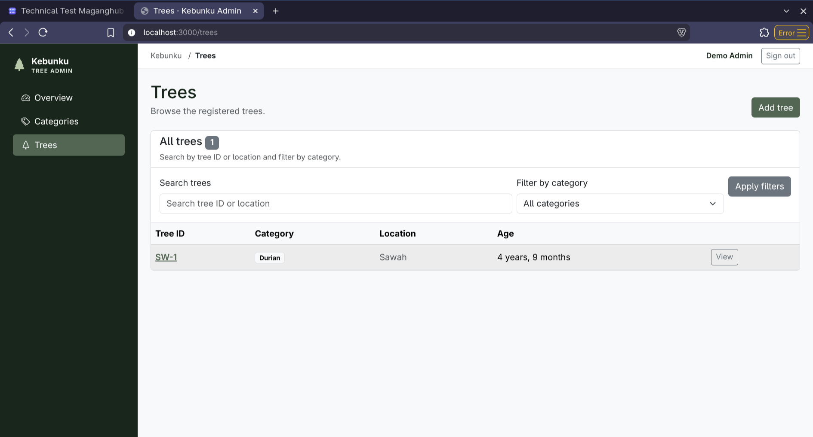
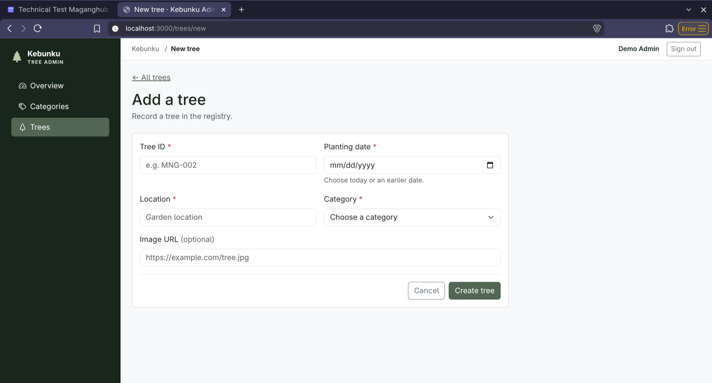
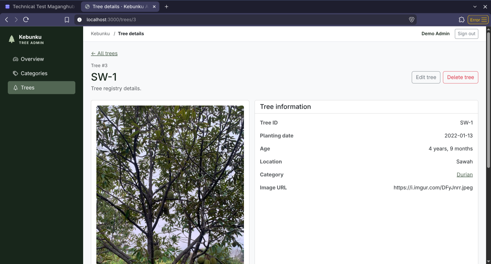

# Kebunku Admin

NestJS admin for Kebunku that organize your tree and it's category. Use EJS for template engine, Bootstrap for CSS-library, cookie sessions, and more

## Main Features

- Categories and trees persist through TypeORM repositories. Dashboard, category, and tree pages and forms require an authenticated admin session; signed-out browser requests redirect to `/login`.
- Category search matches name/code; tree search matches tree ID/location and supports a category filter. Tree ages are computed from planting dates using UTC and are not stored.

## Requirements and setup

### Prerequisites

- Node.js**: v18 or higher (LTS recommended)
- npm: v9 or higher

### Step-by-step Local Setup

1. Install dependencies
   ```bash
   npm install
   ```
2. Configure environment variables
   ```bash
   cp .env.example .env
   ```
3. Build the application
   ```bash
   npm run build
   ```
4. Development mode
   ```bash
   npm run start:dev
   ```
5. Production mode
   ```bash
   npm run start:prd
   ```
6. Access the web
   Open your browser and navigate
   ```bash
   http://localhost:3000
   ```

## Database design



## App screenshots

### Login



### Dashboard



### Categories





### Trees







## Dependencies

- Runtime: `@nestjs/common`, `@nestjs/core`, `@nestjs/platform-express`, `@nestjs/typeorm`, `typeorm`, `sqlite3`, `ejs`, `express-session`, `bcryptjs`, `bootstrap`, `bootstrap-icons`, `dotenv`, `reflect-metadata`, `rxjs`.
- Development: `@nestjs/cli`, `typescript`, `@types/ejs`, `@types/express`, `@types/express-session`, `@types/node`.

## JSON API

All API examples below assume the app is running at `http://localhost:3000`. Set `baseUrl` to another local instance as needed. Both catalog APIs require the admin session cookie; sign in first with `POST /api/auth/login`. Postman stores and sends the `connect.sid` cookie automatically when its cookie jar is enabled. The login route is public, returns `201 Created`, and responds with a safe `{ "admin": { "id", "email", "name" } }` profile.

Use JSON request bodies with `Content-Type: application/json`. NestJS returns `201 Created` for `POST` and `200 OK` for `GET`, `PATCH`, and `DELETE` unless otherwise noted. Category/tree validation is shared with the SSR forms.

### Categories

| Method   | Path                  | Request                                                                         | Success                                            |
| -------- | --------------------- | ------------------------------------------------------------------------------- | -------------------------------------------------- |
| `GET`    | `/api/categories`     | Optional `?search=<name-or-code>`                                               | `200`: array with `treeCount`                      |
| `GET`    | `/api/categories/:id` | Numeric category ID                                                             | `200`: category and trees with computed ages       |
| `POST`   | `/api/categories`     | `{ "name": "My API Category", "code": "MYAPI7" }`                               | `201`: created category                            |
| `PATCH`  | `/api/categories/:id` | Full category body, e.g. `{ "name": "Updated API Category", "code": "MYAPI7" }` | `200`: updated category                            |
| `DELETE` | `/api/categories/:id` | Numeric category ID                                                             | `200`: empty response; fails if trees reference it |

### Trees

| Method   | Path             | Request                                                                                                               | Success                                              |
| -------- | ---------------- | --------------------------------------------------------------------------------------------------------------------- | ---------------------------------------------------- |
| `GET`    | `/api/trees`     | Optional `?search=<tree-id-or-location>&categoryId=<numeric-id>`                                                      | `200`: matching trees with category and computed age |
| `GET`    | `/api/trees/:id` | Numeric tree ID                                                                                                       | `200`: tree with category and computed age           |
| `POST`   | `/api/trees`     | `{ "treeId": "API-DEMO-7", "plantingDate": "2020-01-15", "location": "North plot", "imageUrl": "", "categoryId": 1 }` | `201`: created tree with category and age            |
| `PATCH`  | `/api/trees/:id` | Full tree body using the same fields as create                                                                        | `200`: updated tree                                  |
| `DELETE` | `/api/trees/:id` | Numeric tree ID                                                                                                       | `200`: empty response                                |
