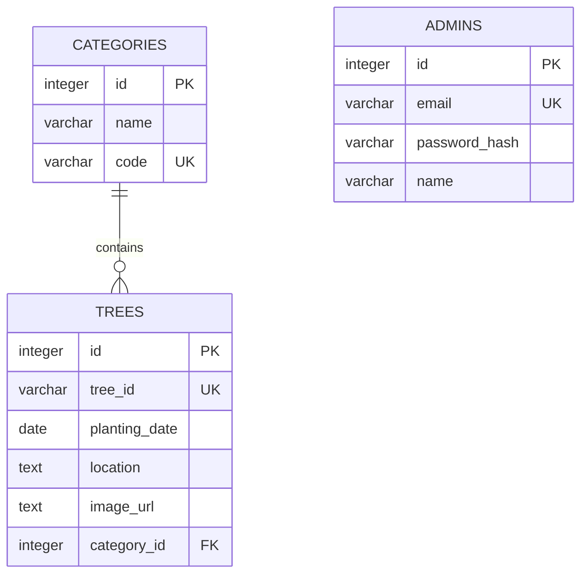

# Kebunku Admin

NestJS admin for Kebunku that organize your tree and it's category. Use EJS for template engine, Bootstrap for CSS-library, cookie sessions, and more

## Main Features

- Categories and trees persist through TypeORM repositories. Dashboard, category, and tree pages and forms require an authenticated admin session; signed-out browser requests redirect to `/login`.
- Category search matches name/code; tree search matches tree ID/location and supports a category filter. Tree ages are computed from planting dates using UTC and are not stored.

## Requirements and setup

### Prerequisites

- Node.js**: v18 or higher (LTS recommended)
- npm: v9 or higher

### Step-by-step Local Setup

1. Install dependencies
   ```bash
   npm install
   ```
2. Configure environment variables
   ```bash
   cp .env.example .env
   ```
3. Build the application
   ```bash
   npm run build
   ```
4. Development mode
   ```bash
   npm run start:dev
   ```
5. Production mode
   ```bash
   npm run start:prd
   ```
6. Access the web
   Open your browser and navigate
   ```bash
   http://localhost:3000
   ```

## Database design



## List API endpoints

## Dependencies and developer notes
