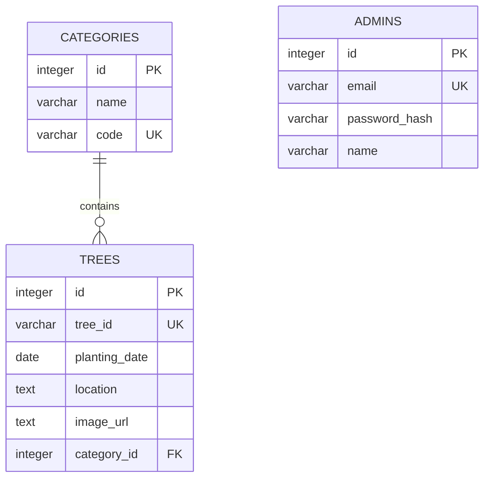

# Kebunku Admin

NestJS admin for Kebunku that organize your tree and it's category. Use EJS for template engine, Bootstrap for CSS-library, cookie sessions, and more

## Main Features

## Requirements and setup

## Database design

## List API endpoints

## Dependencies and developer notes
